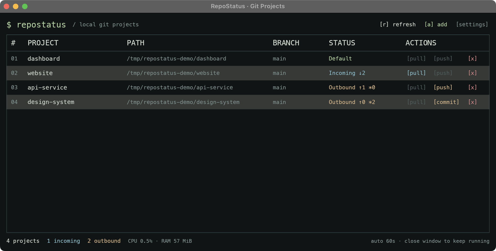
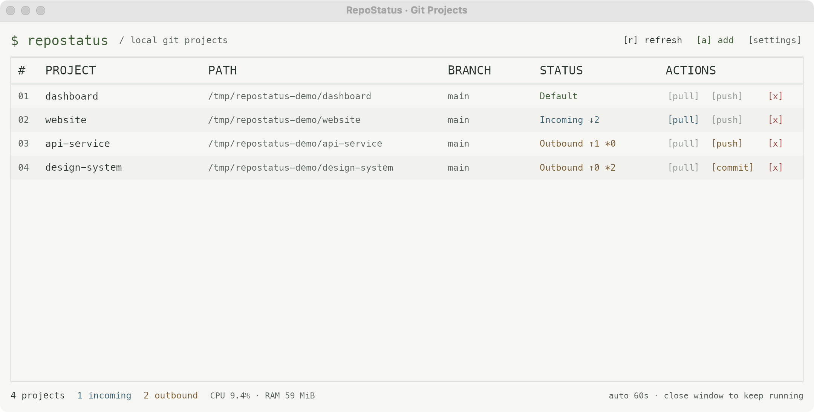
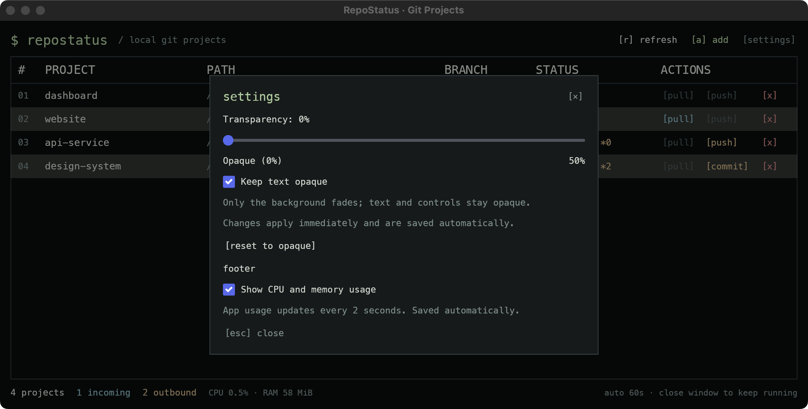

<p align="center">
  
</p>

<h1 align="center">RepoStatus</h1>

<p align="center">Your local Git projects, at a glance.</p>

<p align="center">
  <a href="#getting-started">Getting started</a> ·
  <a href="#using-repostatus">Usage</a> ·
  <a href="#configuration">Configuration</a> ·
  <a href="#development">Development</a>
</p>

RepoStatus is a native desktop dashboard for tracking local Git repositories. See which projects need a pull, have commits ready to push, or contain uncommitted changes—without opening a terminal in every folder. Built with Rust and [Iced](https://iced.rs/), it combines a compact monospace interface with explicit Git actions and background checks.



*Captured on macOS with isolated sample repositories and local remotes. `↓` counts incoming commits, `↑` counts outgoing commits, and `*` counts changed files.*



*Light appearance uses the same dashboard and Git actions.*

## Features

- **One dashboard for multiple repositories.** View paths, branches, status, and available actions together.
- **Background updates.** Fetch and check repositories on startup, every 60 seconds, or on demand.
- **Pull, commit, and push.** Fast-forward pulls, explicit commits, and pushes to the upstream displayed in the dashboard.
- **Useful Git diagnostics.** Identify diverged branches, conflicts, detached HEAD, missing upstreams, and fetch failures.
- **Keyboard shortcuts.** Add a project with `a`, refresh with `r`, and close dialogs with `Esc`.
- **Persistent preferences.** Save your project list, Light/Dark/System theme, window appearance, and resource stats visibility.
- **Menu bar / system tray on macOS and Windows.** Keep checking repositories when the dashboard is hidden.

## Getting started

### Requirements

- **Rust 1.88 or newer**, including Cargo. Install it with [rustup](https://rustup.rs/).
- **Git** available on `PATH`.
- A graphical desktop and working Git credentials for any private remotes.

The project currently ships as source; no prebuilt releases are published. Build and run it locally:

```sh
git clone https://github.com/NucleusBeast/repostatus.git
cd repostatus
cargo run --release --locked
```

To build without launching:

```sh
cargo build --release --locked
```

The executable is `target/release/repostatus` on macOS and Linux, or `target\release\repostatus.exe` on Windows. Keep Git available on `PATH` when launching the executable.

### Platform behavior

| Capability | macOS | Windows | Linux |
| --- | --- | --- | --- |
| Dashboard and Git operations | Yes | Yes | Yes |
| Folder picker | Native | Native | Desktop portal |
| Menu bar / system tray | Yes | Yes | No |
| Closing the window | Keeps running in background | Keeps running in background | Exits |
| Window transparency | Yes | Yes | No |
| CPU and memory stats | Yes | Yes | Yes |

Linux requires the native libraries for an X11 or Wayland desktop. The folder picker also requires `xdg-desktop-portal` and a backend for your desktop environment. Build tools and package names vary by distribution.

## Using RepoStatus

1. Select **[a] add** or press `a`.
2. Browse for an existing Git repository, or enter its path. A subfolder resolves to its repository root; duplicate projects are rejected.
3. Read the branch and status for each project. Hover over its status for incoming/outgoing commit counts, changed-file count, and upstream.
4. Use the available actions, or select **[r] refresh** to fetch and recheck all projects.

### Reading repository status

| Status | Meaning | Next step |
| --- | --- | --- |
| **Default** | Tracked branch with no incoming commits, outgoing commits, or local changes | No action needed |
| **Incoming ↓N** | The upstream has commits your branch does not have | Pull when your working tree is clean and the branch can fast-forward |
| **Outbound ↑N *M** | Local commits and/or changed files need attention | Commit changes, then push outgoing commits |
| **Incoming+Outbound** | Both incoming commits and outgoing commits or local changes exist | Inspect the counts and resolve local changes or divergence as needed |
| **No upstream** | The branch has no tracking branch | Configure its upstream in your normal Git workflow |

Conflicts and detached HEAD are also shown explicitly. A failed fetch displays a warning alongside the last locally known state, so the dashboard may be out of date until fetching succeeds.

### Git actions and safeguards

| Action | Behavior |
| --- | --- |
| **Pull** | Fetches first, then runs `git pull --ff-only`. Requires a clean working tree, incoming commits, no outgoing commits, no conflicts, and an attached branch. |
| **Commit** | Stages **all changed and untracked files** with `git add --all`, then commits with your message. Requires an attached branch without conflicts. Review files in your Git tools first if you need selective staging. |
| **Push** | Fetches first, then pushes committed changes to the displayed upstream. Requires outgoing commits, a configured upstream, and no incoming commits or conflicts. |
| **Remove [x]** | Removes a project from the dashboard after confirmation. Leaves the repository and its files on disk. |

Committing and pushing are separate actions. RepoStatus never force-pushes, resets files, stashes changes, or creates automatic merge commits. Resolve conflicts, divergence, and branch setup with your usual Git tools. Individual Git commands time out after 90 seconds; failed actions display the Git error.

### Background operation

On macOS and Windows, closing the dashboard hides it while repository checks and running operations continue. Left-click the tray icon to hide or restore the dashboard. Right-click it to **Toggle RepoStatus**, **Refresh repositories**, or **Quit RepoStatus**.

On macOS, the app also leaves the Dock and app switcher while hidden and returns when restored. Opening RepoStatus again from Finder, Launchpad, or the Dock shows and focuses the existing dashboard, including when it is hidden or minimized. Tray clicks still toggle the dashboard. If tray creation fails, an error is shown and closing the window exits normally. On Linux, closing the window exits the app.

### Appearance and resource stats



Open **[settings]** to change:

- **Theme:** Choose **Light**, **Dark**, or **System**. Changes apply immediately and are saved. System is the default and follows your desktop appearance, including changes while RepoStatus is running.

- **Transparency (macOS and Windows):** 0% is opaque; the maximum is 50%. **Keep text opaque** fades only the background. With it unchecked, the whole window fades, including text and the title bar. Dialogs remain opaque in background-only mode. **Reset to opaque** restores 0%.
- **CPU and memory usage:** Show or hide app resource usage in the footer. Values update every two seconds; disabling the option stops collection. CPU usage is measured per core, so 100% means one fully used core and usage can exceed 100%. Memory is resident memory in MiB. Git subprocesses are excluded.

Changes apply immediately. Transparency saves when the slider is released; checkboxes save when toggled. Settings are restored at startup.

## Configuration

Projects and preferences are stored together in a local JSON file:

| Platform | Default path |
| --- | --- |
| macOS | `~/Library/Application Support/repostatus/projects.json` |
| Linux | `~/.config/repostatus/projects.json` |
| Windows | `%APPDATA%\repostatus\projects.json` |

Example configuration (replace the paths with your repositories):

```json
{
  "paths": ["/absolute/path/to/repository"],
  "transparency": 0,
  "keep_text_opaque": false,
  "show_stats": true,
  "theme": "system"
}
```

Transparency must be an integer from `0` to `50`. The theme accepts `"light"`, `"dark"`, or `"system"`. New installations default to System appearance, an opaque window, and enabled resource stats. Older project lists without appearance fields load with the same defaults.

Set `REPOSTATUS_CONFIG` to use a separate project list and settings file:

```sh
# macOS / Linux
REPOSTATUS_CONFIG=/absolute/path/to/projects.json cargo run --release --locked
```

```powershell
# Windows PowerShell
$env:REPOSTATUS_CONFIG = 'C:\path\to\projects.json'
cargo run --release --locked
```

Invalid configuration is reported and preserved. Repair the file and restart the app to restore saving. Close the app before manually editing its configuration.

## Troubleshooting

**Authentication or permission errors:** RepoStatus uses your existing SSH configuration and Git credential helpers. Interactive credential prompts are disabled. Configure authentication in a terminal, verify that you can fetch the affected repository there, then refresh the dashboard.

For GitHub HTTPS remotes, you can configure the [GitHub CLI](https://cli.github.com/):

```sh
gh auth login --hostname github.com --git-protocol https
gh auth setup-git
```

This configures HTTPS credentials; an existing SSH remote still needs a working SSH key or must be changed to an HTTPS URL.

**No upstream / Push unavailable:** Set the correct upstream in a terminal. For example, to publish the current branch to `origin` and track it:

```sh
git push -u origin HEAD
```

**Pull unavailable:** Check for uncommitted changes, outgoing commits, conflicts, or detached HEAD. Pull is enabled only when the branch can fast-forward safely.

**Commit fails:** Check the displayed Git error. Git may require `user.name` and `user.email`, or a commit hook may have rejected the commit. Because staging happens before committing, files can remain staged after a failed commit.

**Fetch warning / timeout:** Check network access and remote credentials. Local status remains visible, but remote counts can be stale. Refresh after resolving the problem.

**Linux folder picker does not open:** Verify that a desktop portal and the appropriate backend are installed and running in your graphical session.

## Development

To build signed macOS apps and Windows executables with GitHub Actions, see
[the release setup and publishing guide](docs/releases.md).

```sh
cargo fmt --check
cargo clippy --locked --all-targets -- -D warnings
cargo test --locked
```

Integration tests create isolated repositories and a local bare remote to exercise fetch, pull, commit, push, dirty/diverged branch protection, status parsing, and persistence. They require Git, but no network credentials or user repositories.

| Location | Purpose |
| --- | --- |
| `src/main.rs` | Dashboard, dialogs, keyboard handling, and application state |
| `src/git.rs` | Git commands, status parsing, and action safeguards |
| `src/storage.rs` | Configuration loading and persistence |
| `src/theme.rs` | Theme resolution and dashboard color palettes |
| `src/appearance.rs` | Platform-specific window transparency |
| `src/lifecycle.rs`, `src/tray.rs` | Window visibility and menu bar / tray integration |
| `src/reopen.rs` | macOS app reopening restores the existing window |
| `src/stats.rs` | App CPU and memory sampling |
| `tests/git_workflow.rs` | Isolated Git workflow integration tests |

Report bugs or propose improvements through [GitHub Issues](https://github.com/NucleusBeast/repostatus/issues). Include your OS, Rust and Git versions, reproduction steps, and the error shown by the app. Remove credentials and private repository details from logs and screenshots.

## License and credits

The package declares the **MIT** license in [Cargo.toml](Cargo.toml). Built with [Iced 0.14](https://docs.rs/iced/0.14.0/) and created in [T3 Code](https://t3.codes).
